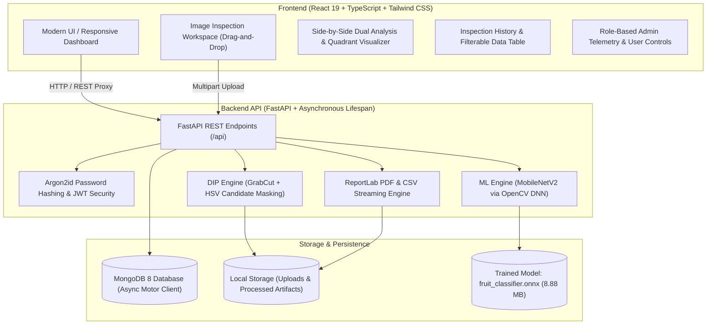

# FruitDefect AI — Full-Stack Fruit and Vegetable Defect Detection System

An enterprise-ready, full-stack computer vision and deep learning platform combining **Digital Image Processing (DIP)** and **Transfer Learning (MobileNetV2)** for automated defect detection, candidate lesion localization, and publication-grade reporting across 14 fruit and vegetable categories.

---

## 1. System Architecture & Capabilities

FruitDefect AI pairs deep learning image classification with digital image processing foreground extraction and color anomaly analysis, supported by a scalable, asynchronous microservice backend and a high-performance modern web frontend.



### Core Capabilities
1. **Whole-Image Deep Learning Classification (MobileNetV2)**:
   - High-confidence binary prediction (`Healthy` vs. `Defective`).
   - Transfer-learning architecture trained on 20,484 augmented images with test accuracy of **98.93%** and macro F1 of **98.93%**.
   - Zero-latency native CPU inference via **OpenCV DNN** (`cv2.dnn.readNetFromONNX`), operating with 100% compliance under Windows 11 User Mode Code Integrity (WDAC/UMCI).
2. **Digital Image Processing (DIP) Anomaly Localization**:
   - $5 \times 5$ Gaussian smoothing for sensor noise reduction.
   - OpenCV GrabCut foreground fruit segmentation with adaptive contour bounding box initialization.
   - Multi-threshold HSV brown and necrotic candidate lesion detection with morphological opening/closing filter passes.
   - Granular pixel area analytics: total fruit area, candidate anomaly area, and candidate defect percentage.
3. **Comprehensive Data & Reporting Services**:
   - Asynchronous persistence in local **MongoDB 8** using `motor`.
   - Dynamic, publication-grade **ReportLab PDF generation** embedding inspection telemetry, comparative visualizations, and QR authenticity metadata.
   - Bulk RFC-4180 CSV export of inspection histories.
4. **Role-Based Access Control (RBAC)**:
   - Argon2id password encryption with secure salt parameters.
   - JWT stateless authentication with auto-refresh and protected route guards.
   - Granular admin management: user status toggling, role escalation, inspection auditing, and server health telemetry.

---

## 2. Supported Fruit and Vegetable Categories

The system supports binary classification and candidate defect region analysis across all 14 categories from the training dataset:

| Category | Category | Category | Category |
| :--- | :--- | :--- | :--- |
| 🍎 **Apple** | 🍌 **Banana** | 🫑 **Bellpepper** | 🥕 **Carrot** |
| 🥒 **Cucumber** | 🍇 **Grape** | 🍈 **Guava** | 🫐 **Jujube** |
| 🥭 **Mango** | 🍊 **Orange** | 🍅 **Pomegranate** | 🥔 **Potato** |
| 🍓 **Strawberry** | 🍅 **Tomato** | | |

---

## 3. Technology Stack

### Backend
- **Framework**: FastAPI 0.115+ (Python 3.11)
- **Database Driver**: Motor 3.7+ (AsyncIO MongoDB driver) & PyMongo 4.9+
- **Inference Engine**: OpenCV DNN (`cv2.dnn.readNetFromONNX`) with ONNX Runtime parity
- **Image Processing**: OpenCV 5.0.0 (`cv2`), NumPy 2.0.2, Pillow 11.1+
- **Security & Crypto**: Argon2id (`argon2-cffi`), PyJWT, Pydantic V2 (`email-validator`)
- **Reporting**: ReportLab 4.4+ (Vector PDF creation), Python standard `csv`
- **Testing**: Pytest 9.2+, `pytest-asyncio`, Starlette TestClient

### Frontend
- **Framework**: React 19, TypeScript 5.7, Vite 6
- **Routing & State**: React Router DOM 7, React Context API
- **Styling**: Tailwind CSS 3.4 (`#1B4332` Forest Green, `#5C8C6B` Muted Sage, `#FAF9F6` Warm Ivory)
- **Icons & Visuals**: Lucide React
- **Data Visualization**: Recharts (Interactive Area & Donut charts)
- **Forms & Validation**: React Hook Form, Zod

### Database & Environment
- **Database**: MongoDB Server 8.3.2 (Local Windows Service listening on `127.0.0.1:27017`)
- **OS**: Windows 11 with User Mode Code Integrity (WDAC/UMCI) enforcement

---

## 4. Directory Structure

```text
FruitDefectDetection/
├── backend/
│   ├── app/
│   │   ├── api/                     # REST API route handlers
│   │   │   ├── auth.py              # Login, register, me, profile, password
│   │   │   ├── inspections.py       # Upload, single inspect, list, get, delete
│   │   │   ├── dashboard.py         # 7-day analytics, metrics, stats
│   │   │   ├── reports.py           # ReportLab PDF & CSV log export
│   │   │   ├── admin.py             # User administration & system metrics
│   │   │   ├── system.py            # Health probe & model status telemetry
│   │   │   └── files.py             # Secure static artifact serving
│   │   ├── core/                    # Config, security, dependencies
│   │   ├── database/                # MongoDB motor client & indexing
│   │   ├── schemas/                 # Pydantic v2 data models
│   │   ├── services/                # ML engine, DIP engine, reports, inspections
│   │   └── main.py                  # FastAPI application entry & lifespan
│   ├── storage/                     # Uploads and processed visual results
│   └── requirements.txt             # Backend dependencies
├── frontend/
│   ├── src/
│   │   ├── components/              # Layout, Navbar, Footer, StatusBadge, Spinner
│   │   ├── contexts/                # AuthContext with persistent session
│   │   ├── pages/                   # Landing, Login, Register, Dashboard,
│   │   │                            # Inspection, Results, History, Profile, Admin
│   │   ├── services/                # Axios API client with auth interceptors
│   │   ├── types/                   # TypeScript interface definitions
│   │   ├── App.tsx                  # React Router configuration
│   │   └── main.tsx                 # DOM entry point
│   ├── package.json
│   ├── vite.config.ts
│   └── tailwind.config.js
├── models/
│   ├── fruit_classifier.onnx        # Trained MobileNetV2 ONNX weights (8.88 MB)
│   ├── fruit_classifier.pth         # PyTorch checkpoint (27.10 MB)
│   └── class_labels.json            # Architecture & normalization parameters
├── modules/                         # Core DIP & classifier utilities
│   ├── preprocessing.py             # Gaussian smoothing & HSV conversion
│   ├── segmentation.py              # OpenCV GrabCut segmentation
│   ├── analysis.py                  # HSV brown/dark candidate anomaly detection
│   └── classifier.py                # OpenCV DNN MobileNetV2 inference
├── tests/
│   ├── test_backend_comprehensive.py # Comprehensive pytest integration suite
│   └── conftest.py
├── run_all.bat                      # 1-Click launcher for full-stack system
├── run_backend.bat                  # Dedicated FastAPI backend launcher
├── run_frontend.bat                 # Dedicated React frontend launcher
├── app.py                           # Legacy Streamlit interactive interface
├── predict.py                       # CLI inference & pipeline tool
├── evaluate_model.py                # Evaluation & data audit script
└── README.md
```

---

## 5. Quick Start Instructions

### Prerequisites
1. **Python 3.11** installed with virtual environment at `.venv`.
2. **Node.js 20+** and **npm** installed.
3. **MongoDB 8** running locally (`net start MongoDB` or verify service is active on port `27017`).

### 1-Click Launch (Recommended)
Double-click or run from PowerShell:
```powershell
.\run_all.bat
```
This automatically launches:
- **FastAPI Backend Server**: [http://127.0.0.1:8000](http://127.0.0.1:8000) (Swagger Docs at [/docs](http://127.0.0.1:8000/docs))
- **React Frontend Application**: [http://127.0.0.1:5173](http://127.0.0.1:5173)

---

### Manual Launch

#### Step 1: Start Backend
In PowerShell:
```powershell
.\run_backend.bat
# Or manually via Python:
.\.venv\Scripts\python.exe -m uvicorn backend.app.main:app --reload --host 127.0.0.1 --port 8000
```

> **Note on Windows Application Control (WDAC)**: Always use `python.exe -m uvicorn ...` instead of `uvicorn.exe`. Community pip executables are unsigned stubs blocked by Windows UMCI; invoking via signed `python.exe` runs flawlessly.

#### Step 2: Start Frontend
In a new terminal:
```powershell
.\run_frontend.bat
# Or manually via npm:
cd frontend
npm run dev
```

Visit **[http://127.0.0.1:5173](http://127.0.0.1:5173)** in your browser.

---

## 6. Testing & Quality Assurance

### Run the Comprehensive Pytest Suite
Verify all authentication, authorization, ML inference parity, GrabCut processing, MongoDB transactions, PDF reporting, and CSV exports:

```powershell
.\.venv\Scripts\python.exe -m pytest -v tests/test_backend_comprehensive.py
```

### Verify Model Inference Parity
Verify that the FastAPI `MLEngine` produces mathematically identical outputs to the baseline `predict.py`:

```powershell
.\.venv\Scripts\python.exe -c "
from modules.classifier import FruitClassifier
from backend.app.services.ml_engine import ml_engine
from PIL import Image
import numpy as np

img = np.array(Image.open('ml_data/test/healthy/Apple__Healthy_00000.png').convert('RGB'))
res_cli = FruitClassifier().predict(img)
res_api = ml_engine.predict(img)

assert res_cli['prediction'] == res_api['prediction']
assert abs(res_cli['confidence'] - res_api['confidence']) < 1e-4
print('Inference parity 100% verified!')
"
```

---

## 7. Model Performance & Evaluation History

The included MobileNetV2 model was trained on 20,484 training images using WSL2 Ubuntu with CUDA acceleration on an NVIDIA GeForce RTX 2050 GPU:

### Independent Test Set Results (4,413 Images)
- **Accuracy**: 98.93%
- **Macro Precision**: 98.91%
- **Macro Recall**: 98.96%
- **Macro F1-Score**: 98.93%
- **Healthy Test Samples**: 2,078 images
- **Defective Test Samples**: 2,335 images

---

## 8. Scientific Distinction & Disclaimer

> [!IMPORTANT]
> **Advisory Disclaimer & Operational Scope**:
> 1. **Image-Level vs. Defect Localization**:
>    - **MobileNetV2** predicts whether an image exhibits general healthy or defective visual characteristics based on global learned representations.
>    - **OpenCV HSV Segmentation** isolates brown/dark candidate chromatic regions. This can include natural physiological markings, ripening sugar spots (e.g., in bananas), or surface shadowing.
> 2. **Candidate Anomaly Metrics**:
>    - Candidate anomaly percentages generated by DIP are exploratory indicators and are **not** scientifically validated defect proportions.
> 3. **Food Safety Advisory**:
>    - This software is an agricultural computer vision evaluation tool. It **does not** certify food safety, microbial safety, or human edibility.
# fruit-defect-detection

# fruit-defect-detection

# fruit-defect-detection

